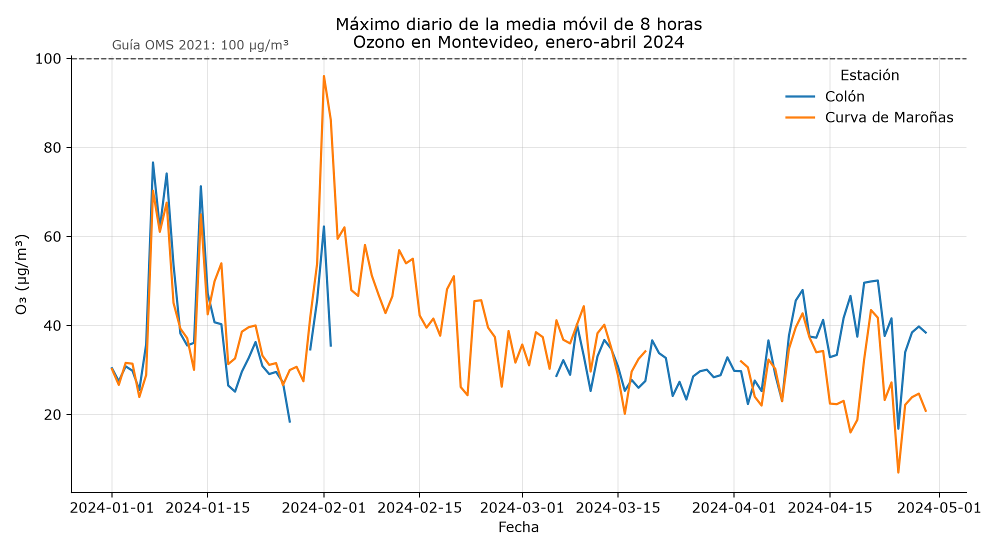

# CienciaDatos_JFM

Bitácora personal del curso **Introducción a la Ciencia de Datos**
(Universidad de Montevideo, Facultad de Ciencias Empresariales y Economía,
segundo semestre de 2026).

Material del curso: <https://github.com/DavytJ/Introduccion-a-la-ciencia-de-datos>

## Estructura

```
CienciaDatos_JFM/
├── clases/      un script por actividad, en una carpeta por clase
├── datos/       script que baja los datos y ficha de fuentes (los datos no se suben)
├── diario/      una entrada por semana: qué intenté, qué falló, qué decidí
├── errores/     errores cometidos, cómo se detectaron y cómo se arreglaron
├── funciones/   utilidades propias, con casos de prueba
├── recetas/     procedimientos resueltos, para reusar
└── graficos/    gráficos que generan los scripts
```

## Trabajos

| Clase | Tema | Archivo | Datos |
|---|---|---|---|
| 3 | Fundamentos: objetos, tipos y errores | [`clase03_ejercicio_fundamentos.pdf`](clases/clase03/clase03_ejercicio_fundamentos.pdf) | — |
| 3 | Crear un dataset y volver a cargarlo (8 ejercicios y desafío por equipo) | [`clase03_cargar_datos.py`](clases/clase03/clase03_cargar_datos.py) | los genera `generar_archivos.py` |
| 5 | Carga e inspección: Directorio de Empresas Industriales | [`clase05_empresas_dei.py`](clases/clase05/clase05_empresas_dei.py) | `empresasdei_20230330.csv` |
| 7 | Carga y transformación del ozono | [`clase07_carga_y_transformacion_ozono.py`](clases/clase07/clase07_carga_y_transformacion_ozono.py) | `o3_01_2024_04_2024.csv` |
| 7 | Máximo diario de la media móvil de 8 horas (guía OMS) | [`clase07_ozono_max_8h.py`](clases/clase07/clase07_ozono_max_8h.py) | `o3_01_2024_04_2024.csv` |
| 10 | ¿El tránsito ensucia el aire? Tres Cruces, junio de 2024 | [`clase10_transito_aire.py`](clases/clase10/clase10_transito_aire.py) | conteo vehicular, NO2 y PM2.5 |
| 11 | Leer un ticket con IA (Gemini) | [`clase11_leer_ticket.py`](clases/clase11/clase11_leer_ticket.py) | `ticket.jpg` y clave propia |
| 12 | Tránsito y aire: faltantes, franjas y modelos (7 ejercicios) | [`clase12_ejercicios_transito_aire.py`](clases/clase12/clase12_ejercicios_transito_aire.py) | `transito_aire_junio2024.csv` |
| 14 | Unir tablas (ejercicios 58 a 61, en papel) | [`clase14_unir_tablas.md`](clases/clase14/clase14_unir_tablas.md) y [`.py`](clases/clase14/clase14_unir_tablas.py) | — |



## Cómo correrlo

Con Python 3.11 o más nuevo, desde la carpeta del repositorio:

```
pip install -r requirements.txt
python datos/obtener_datos.py
python funciones/test_utilidades.py
```

Después, cualquier script de `clases/`. Todos arman las rutas desde la raíz
del repositorio, así que funcionan en cualquier computadora sin tocar nada.
En Windows, `py -3.13` en lugar de `python`; más detalles en
[`recetas/correr_scripts_en_vscode.md`](recetas/correr_scripts_en_vscode.md).

El único que necesita algo más es el de la clase 11: una clave de Gemini
propia en `datos/clave_gemini.txt`, que Git ignora. Sin clave, el script corre
hasta antes del envío y avisa.

## Datos

Los datos crudos no se versionan. `datos/obtener_datos.py` los baja del
Catálogo de Datos Abiertos y del repositorio del curso, y comprueba la
cantidad de filas. Origen, licencia, período y filas de cada archivo:
[`datos/fuentes.md`](datos/fuentes.md).

## Uso de asistentes de IA

Usé Claude (Anthropic) en estas partes del trabajo:

- **Clase 7 (septiembre).** Los dos scripts de ozono se escribieron con
  Claude a partir del material de la clase, que estaba en R.
- **Clase 10 (septiembre).** El script es el de la cátedra; Claude me ayudó
  a instalar lo necesario y a correrlo.
- **Preparación del parcial (octubre).** Resumen de estudio y explicación del
  parcial de ejemplo.
- **Noviembre.** Reorganización del repositorio; `datos/obtener_datos.py` y
  `datos/fuentes.md`; las funciones y sus pruebas; las recetas; la
  resolución de las actividades de las clases 3, 11, 12 y 14; y la redacción
  del diario y de los errores a partir de mis commits, mis archivos y mis
  conversaciones.

En la clase 11 la IA es además parte del análisis: el script le pide a
Gemini que lea la foto de un ticket.

Cómo se verificó:

- Cada script se corrió completo, desde una carpeta distinta a la suya, con
  los datos que baja `obtener_datos.py`.
- Las respuestas de la clase 3, de los ejercicios 1 a 4 de la clase 12 y de
  los ejercicios 58 a 61 se contrastaron con las soluciones publicadas en el
  repositorio del curso. Los ejercicios 5 a 7 de la clase 12 no tienen
  solución publicada.
- El script de la clase 14 comprueba cada respuesta con `assert`.
- Las funciones tienen casos de prueba (`funciones/test_utilidades.py`).
- En la clase 11, la tabla que devuelve el modelo se controla contra el
  total impreso en el ticket.
